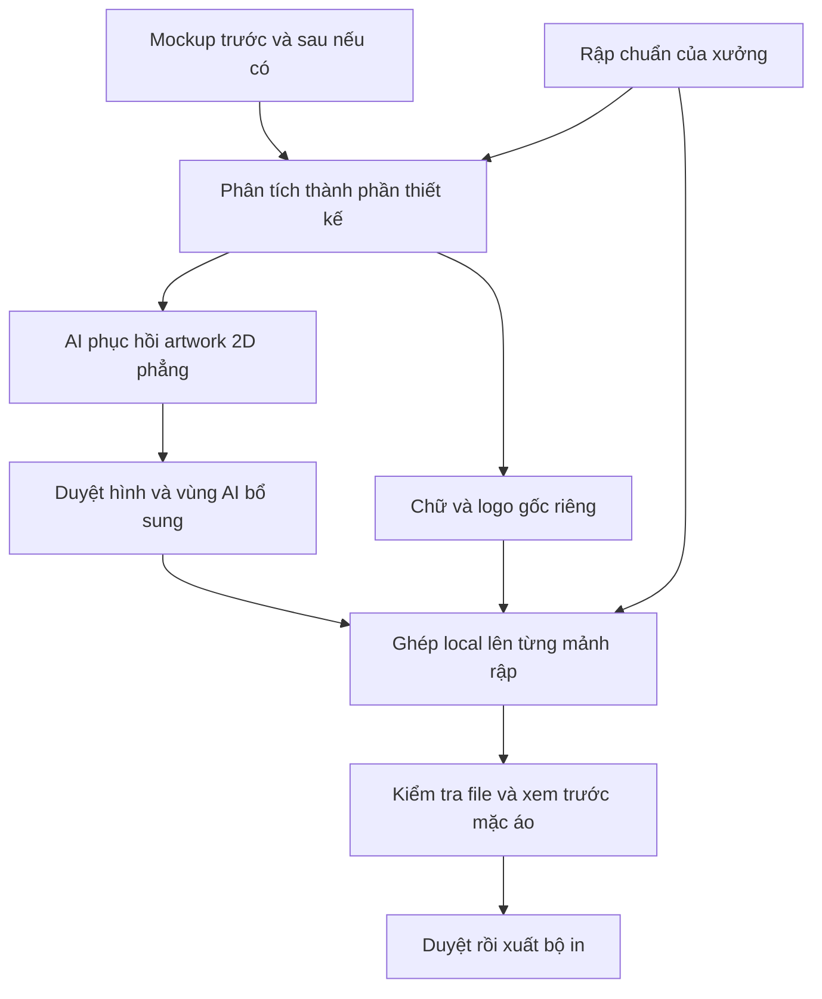

# Từ mockup đến rập in

Ngày đối chiếu nguồn: 26/10/2026. Phạm vi: quy trình đã được công bố, khả năng áp dụng cho POD Studio và Mac mini RAM 16 GB. Đây là nghiên cứu; chưa chạy benchmark mới, chưa cài repo hay gọi tạo ảnh trả phí.

## Kết quả chính

Đã có hướng làm gần với ảnh bạn gửi: dùng mockup để phục hồi đồ họa 2D, sau đó chuẩn bị từng file artwork cho sản xuất. Nguồn công khai rõ nhất tìm được là hướng dẫn của GoCustom. Tuy nhiên, hướng dẫn đó không chứng minh một lần generate có thể tạo toàn bộ bộ rập AOP đúng kích thước và dùng ngay tại mọi xưởng.

Đề xuất cho POD Studio là **phục hồi artwork trước, ghép lên rập có sẵn sau**. Giữ hình học rập, kích thước, vùng an toàn và thông số xuất file bằng xử lý local. Dùng AI cho phần hình ảnh cần dựng lại; giữ chữ và logo thành thành phần riêng có thể kiểm tra.

## Các quy trình có nguồn

| Nguồn | Quy trình được mô tả | Có thể học gì | Giới hạn bằng chứng |
|---|---|---|---|
| [GoCustom — AI artwork](https://gocustom.com/faq/faqs/can-you-produce-garments-from-ai-generated-designs) | Từ mockup AI, yêu cầu xuất riêng đồ họa 2D phẳng, bỏ nếp vải, ánh sáng và bóng; cung cấp từng artwork cho vị trí in | Tách hình ảnh thiết kế khỏi ảnh chiếc áo trước khi chuẩn bị file | Hướng dẫn cho khách; không phải thử nghiệm đo độ chính xác của bộ rập AOP tự động |
| [HTT Apparel — Artwork FAQ](https://www.httapparel.com/artwork-faq) | Dùng mockup làm tham chiếu; dùng file gốc hoặc dựng lại artwork. In sublimation cần từng panel ở kích thước thực | Cần bước dựng lại và duyệt chữ/logo, không chỉ phóng lớn ảnh | Không cung cấp pipeline mã nguồn hoặc cam kết tự động hóa |
| [Printful — chuẩn bị file](https://help.printful.com/hc/en-us/articles/50264019148177-How-should-I-prepare-my-print-file-for-the-best-results) | Tải template theo sản phẩm, đặt artwork trong vùng hướng dẫn, bỏ lớp guide rồi xuất theo yêu cầu | Lấy rập và yêu cầu xuất file từ sản phẩm/xưởng đích | Đây chủ yếu là chiều artwork → sản phẩm, không phải phục hồi artwork từ mockup |
| [Subliminator — cut and sew](https://www.subliminator.com/blog-posts/how-to-prepare-all-over-print-designs) | Chuẩn bị theo từng panel/size, tính bleed và phần đường may, xem trước theo size | Bố cục cần xét theo size; thiết kế phải chịu được sai lệch ở đường ráp | Mức bleed và dung sai phải lấy từ nhà sản xuất cụ thể |
| [DIY Printz Studio](https://diyprintz.com/pages/diy-printz-studio) | Công bố chuỗi skill: thiết kế → mockup → nội dung bán hàng → xử lý khách | Có tiền lệ đóng gói quy tắc in và các bước thành skill chuyên biệt | Nguồn giới thiệu của nhà cung cấp; chủ yếu luồng thiết kế mới/DTF, không chứng minh chuyển mockup thành rập hoodie AOP |

Các nguồn trên mô tả những phần khác nhau của công việc. Không nên gộp chúng thành tuyên bố rằng đã có một tool duy nhất làm trọn vẹn bài toán của bạn.

## Hiểu đúng ảnh tham khảo

Ảnh chụp cho thấy tác giả nói đã phân tích template, tạo skill và cho ChatGPT generate; bên dưới là ảnh áo, một bố cục trải phẳng và một bản được mô tả là designer làm. Chưa có đường dẫn bài gốc, prompt, skill, file template hay file xuất đầy đủ để xác minh quy trình đó.

Từ ảnh thu nhỏ chưa xác định được canvas có đúng thông số xưởng, từng mảnh có tách riêng, chữ có nguyên vẹn, hay phần ghép khóa kéo/đường may có đúng hay không. Cách diễn giải khả thi là tác giả đã chuẩn hóa kiến thức template thành hướng dẫn để AI dựng một bản bố cục. Đây là suy luận, chưa phải quy trình gốc được xác thực.

Nếu xây skill tương tự, nó nên chứa: danh sách mảnh; kích thước và hướng từng mảnh; mask rập cố định; cut line/safe zone/bleed theo xưởng; quy tắc đối xứng; vị trí logo/chữ; ví dụ đạt và lỗi phải loại; yêu cầu xuất file. Hiệu quả của bộ hướng dẫn này vẫn cần đo qua mẫu thử, không mặc định cải thiện chỉ vì gọi là skill.

## Repo và nghiên cứu đáng xem

| Công cụ/nghiên cứu | Vai trò thực tế | Quyết định đề xuất |
|---|---|---|
| [VTracer](https://github.com/visioncortex/vtracer) | Chuyển raster sang SVG; mã nguồn MIT, có thư viện Python và công cụ dòng lệnh | Ưu tiên thử với mảng màu, biểu tượng và đường nét đã được phục hồi sạch. Không coi vector hóa là sửa chính tả hoặc khôi phục logo gốc |
| [SAM 2](https://github.com/facebookresearch/sam2) | Phân vùng đối tượng để lấy mask; không trải phẳng đồ họa | Chỉ thêm nếu bước tách áo/thành phần đang là nút thắt. Chưa đo hiệu năng trên máy này |
| [DeepIron](https://arxiv.org/abs/2310.15447) | Nghiên cứu suy ra texture chưa biến dạng cho các mảnh may từ ảnh áo bị biến dạng/che khuất | Rất sát bài toán về mặt ý tưởng; chưa xác nhận được gói mã nguồn sẵn chạy phù hợp hệ thống hiện tại |
| [OmniFabric](https://github.com/humansensinglab/OmniFabric) | Khởi tạo texture thô từ mesh ước lượng và VLM, rồi tinh chỉnh trong không gian UV/rập may | Theo dõi hướng tiếp cận; repo nói code và pretrained model đang được chuẩn bị, chưa có căn cứ để cài dùng ngay |
| [Garment3DGen](https://github.com/nsarafianos/Garment3DGen) | Dựng/chỉnh hình học và texture cho tài sản áo 3D | Chưa ưu tiên trên Mac này: hướng dẫn hiện dựa vào CUDA 11.8, nvdiffrast và PyTorch3D; không phải bộ xuất rập in xưởng trực tiếp |

[Tài liệu demo SAM 2](https://github.com/facebookresearch/sam2/blob/main/demo/README.md) có đường chạy MPS/CPU, đồng thời ghi nhận vấn đề bộ nhớ MPS; Docker trên macOS trong cấu hình demo đó dùng CPU. Vì vậy, nếu thử thì nên bắt đầu một ảnh/mô hình nhỏ, không triển khai thêm cả dịch vụ video. Không có số đo RAM/tốc độ mới trong nghiên cứu này.

## Điểm cần đổi trong POD Studio

Luồng hiện tại là: mockup → unwrap bằng template đã hiệu chỉnh → điền vùng thiếu → upscale local → tùy chọn OpenAI làm sạch từng panel → khôi phục canvas/DPI → ZIP.

Trong `pod-studio/openai_api.py`, lời nhắc hiện yêu cầu làm sạch bảo thủ và giữ nguyên bố cục; đầu vào là một panel đã xử lý, thu nhỏ tối đa 1600 px cạnh dài. Kết quả API 1K/2K được đưa trở lại kích thước panel. Luồng này phù hợp thử làm sạch, nhưng chưa phải bước dựng lại artwork có cấu trúc từ mockup gốc.

Nếu chữ hoặc hoa văn đã sai ở kết quả unwrap, yêu cầu giữ nguyên đầu vào có thể giữ lại chính lỗi đó. Đưa ảnh 1K trở lại canvas 6048 px cũng không chứng minh đã có chi tiết gốc tương ứng. Đổi nhãn DPI không tự bổ sung thông tin hình ảnh.

Luồng đề xuất dưới đây là thiết kế cải tiến của nghiên cứu này, chưa phải kết quả benchmark:

1. **Chốt rập đích.** Nạp template đúng sản phẩm/size; giữ nguyên mask, hướng và kích thước. Nếu ảnh mockup khác dáng, dùng quy trình dựng artwork thay vì cố ép map của dáng cũ.
2. **Lập bản phân tích thiết kế.** Chia thành nền, họa tiết lặp, hình chính, chữ, logo và vùng không quan sát được. Chỉ rõ phần đã biết và phần phải suy đoán.
3. **Phục hồi artwork phẳng.** Cho AI tập trung vào từng hình hoặc panel quan trọng; bỏ bóng, nếp vải và hiệu ứng chụp. Không giao cho AI tự quyết định đường cắt hoặc xuất một tờ rập tổng hợp làm file sản xuất cuối.
4. **Duyệt chữ/logo riêng.** Ưu tiên tài sản gốc và chữ gõ lại theo nội dung được duyệt. Chỉ vector hóa những gì đã đúng về hình dạng.
5. **Ghép local.** Đặt artwork theo tọa độ đã chuẩn hóa trên rập, áp dụng crop/mask/bleed theo xưởng; quản lý hướng lật và mảnh đối xứng rõ ràng.
6. **Xem trước và kiểm tra.** So vị trí artwork khi đưa lại lên áo với ảnh tham chiếu, rồi kiểm tra từng file ở kích thước in thực.

OpenAI cũng ghi nhận giới hạn về độ rõ/vị trí chữ, tính nhất quán và việc đặt thành phần trong bố cục nhạy về vị trí. Đó là lý do nên để code giữ hình học rập và tách bước duyệt chữ khỏi sinh ảnh. [Tài liệu OpenAI](https://developers.openai.com/api/docs/guides/image-generation)

## Phép thử nhỏ nên làm tiếp

Chọn một mẫu có đủ ảnh trước/sau và có bộ artwork designer đã được duyệt để đối chiếu. Chỉ chọn một sản phẩm và một size trước.

| Nhánh | Cách thử | Mục đích |
|---|---|---|
| A | Luồng local hiện tại | Giữ mốc so sánh thời gian và lỗi |
| B | AI phục hồi artwork từ mockup, sau đó ghép local lên rập cố định | Kiểm tra hướng cải tiến chính |
| C | AI sinh cả bố cục trải phẳng từ mockup và ảnh template | So với kiểu kết quả trong screenshot; coi là bản nháp để so sánh |

Không đưa bản artwork designer đích cho model trong thử nghiệm mù. Giữ nó cho người chấm; nếu cho model xem thì phải ghi rõ đó là nhánh có artwork tham chiếu, không gọi là phục hồi chỉ từ mockup.

Tiêu chí duyệt đề xuất: đúng toàn bộ chữ; logo không bị biến dạng; đủ tên/số mảnh và đúng kích thước; nội dung quan trọng nằm trong safe zone; nền phủ bleed; các vị trí ráp trông hợp lý trong dung sai xưởng; không còn bóng/nếp áo bị in vào artwork; vùng không thấy trên mockup được đánh dấu để duyệt. Ghi cả thời gian sửa tay và số yêu cầu API, không chỉ chấm ảnh tổng thể.

Trong thử nghiệm ban đầu, chỉ cần dựng Front để xác định AI có phục hồi tốt hơn bản local hay không. Khi đã qua bước đó mới mở rộng sang Back và tay áo. Không cần gọi lại model để thay tọa độ ghép, DPI hay đóng ZIP.

## Giới hạn kết luận

Chưa xác minh được bài gốc trong ảnh; chưa tái lập skill của tác giả; chưa đo được chất lượng của luồng đề xuất trên mẫu của bạn. Nguồn học thuật về texture 3D không tương đương chứng nhận file in xưởng. Mặt khuất vẫn cần thêm ảnh/tài sản gốc hoặc chấp nhận phần AI dựng bổ sung.

Ưu tiên triển khai đề xuất: **thêm bước phục hồi artwork và duyệt trước khi ghép rập**, sau đó mới xét VTracer hoặc SAM 2 nếu thử nghiệm cho thấy cần. Chưa có lý do đủ mạnh để cài thêm toàn bộ pipeline 3D vào Mac mini ở giai đoạn này.
